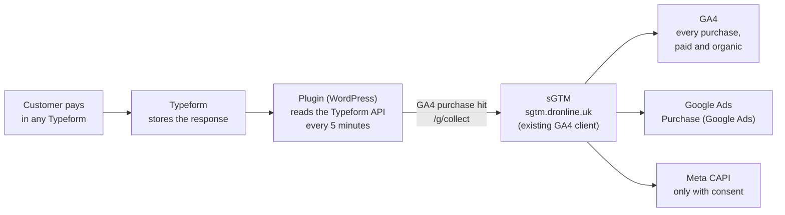
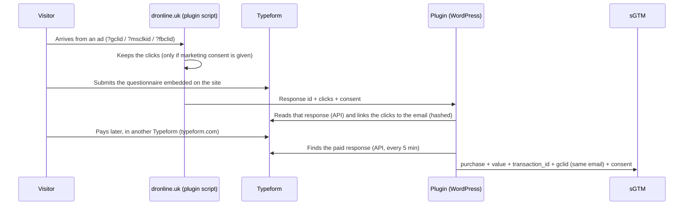

# Typeform Purchase UK (English guide)

WordPress plugin for **dronline.uk** that sends every paid Typeform purchase to **GA4** and to the **Google Ads "Purchase (Google Ads)"** conversion, through the sGTM that already exists. Developed by Arménio Ganga - Dronline. Current version: **0.5.1**.

**Why:** today none of the UK Typeform sales reach GA4 or Google Ads as a purchase. Most of them are paid in Typeforms that open on typeform.com, where the website GTM cannot see them.

**What changes in GTM / sGTM:** nothing. The plugin sends each purchase in the same format the website already uses to send GA4 to the sGTM, so the existing tags handle it.

## How it works



1. The plugin uses a **read-only Typeform API token**. Every 5 minutes it reads the recent responses of every form that has a payment block. Forms created later are picked up automatically, because the form list is checked again every 6 hours.
2. A response only counts as a purchase when the **payment block is confirmed** (`completed: true`). The value is the amount actually charged. Failed payments and responses without a payment are ignored.
3. Each purchase is sent once, with `transaction_id = tf_<response_id>`, to `https://sgtm.dronline.uk/g/collect`. That is the same endpoint and format the website GTM uses for GA4.
4. The **existing** sGTM tags fire on the `purchase` event, exactly as they do for website purchases:
   - GA4 (forward to Google)
   - Google Ads (Purchase), with the Order ID from the `transaction_id`
   - Meta CAPI (only with ad storage consent)

## Linking the purchase to the ad click



- The clicks are matched **by email** (stored only as a SHA-256 hash, for 30 days) or by the response id when the payment form itself is embedded on the site.
- A purchase with no site visit waits up to 45 minutes for the visit data, because the Typeform API can take ~30 minutes to return a new response. After that it is sent anyway, without clicks.
- If the sGTM does not answer, the plugin retries every 5 minutes for up to 71 hours, without ever sending the same purchase twice.

## Consent (Complianz, opt-in)

| Visitor's choice on the cookie banner | What is sent to the sGTM |
|---|---|
| Accepted marketing | Purchase + clicks (gclid, gbraid, wbraid, msclkid, fbc, fbp) + hashed email, `gcs=G11x`, `npa=0` |
| Refused marketing | Purchase only (value, form), no clicks, no email, `gcs=G10x`, `npa=1` |
| No record (paid without visiting the site) | Same as refused |

The `_ga` client id is only sent when statistics were accepted. GA4 always receives the purchase. Google Ads and Meta apply the consent state, just as they do for website hits.

## Installation on dronline.uk

1. **Typeform access:** the account that creates the token must be able to see the responses of **every workspace with payment forms**. Today the "Follow up Weight Loss Consultation" workspace is still missing.
2. **Token:** Typeform → Settings → Personal tokens → Generate, with `forms:read` and `responses:read` only. Keep it in the password manager and never send it by chat or email.
3. **Install:** WordPress → Plugins → Add New → Upload Plugin → `typeform-purchase-uk.zip` → Activate. The plugin appears in the left menu as **Typeform UK**, with the Dronline icon.
4. **Settings** (Typeform UK page):

   | Setting | Value |
   |---|---|
   | Typeform token | paste it, Save, then click **Test the token** (expect "Token OK: it can access N forms") |
   | sGTM URL | `https://sgtm.dronline.uk` |
   | GA4 Measurement ID | `G-KD0WK0RF22` |
   | sGTM Preview (testing only) | **leave empty** |
   | Currency | `GBP` |

5. **Check:** "Form scan" shows the number of forms with payment. New purchases appear under "Latest events" (`found`, then `sent`).

## Validation

- **Plugin:** "Latest events" shows `found` and then `sent to sGTM`, with the value and the transaction id.
- **GA4:** Realtime / DebugView shows `purchase` events with `source = typeform`.
- **Google Ads:** "Purchase (Google Ads)" conversions appear 24 to 48 hours later.
- **Totals:** after one week, compare the totals with Typeform or Stripe.

**Testing before going live:** open Preview in the sGTM, then ⋮ → "Send requests manually", and copy the `X-Gtm-Server-Preview` value into "sGTM Preview (testing only)". Purchases then go to the Preview window. Remember that tags fire for real in Preview.

## Already tested (27 Oct 2026)

- **Automated tests:** 95 local tests pass, using a simulated Typeform API and a fake sGTM.
- **Real Typeform:** the token finds the 25 forms with payment it can access. A real purchase (Flow, £59) was read correctly.
- **Real sGTM (Preview, published container unchanged):**
  - With consent refused: GA4 and Google Ads received the purchase, and Meta sent nothing.
  - With consent accepted: the Google Ads conversion carried the gclid, the value and the Order ID, and Meta fired.

## Known limitations

- **No ad link without a site visit:** a purchase made without passing through the site has no gclid, so Google Ads cannot attribute it to a click. It still counts in GA4.
- **Location in GA4:** GA4 sees the server IP, so the location of Typeform purchases shows the server's region.
- **Delay:** purchases arrive in GA4 / Google Ads with a delay of up to ~35 minutes (Typeform API delay plus the 5-minute schedule).
- **Bing (Microsoft Ads):** not included yet.

## For developers

```bash
docker compose up -d     # local WordPress on http://localhost:8088 (OrbStack)
tests/run-all.sh         # 95 tests
```

The Typeform API is simulated by `tests/mu-typeform-mock.php`, and the `echo` container plays the sGTM. The main documentation, in Portuguese, is in [README.md](../README.md).
